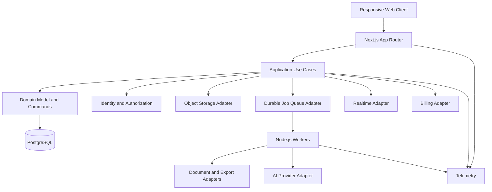

# System Architecture

## Architecture objective
Build a fast, accessible, responsive and extensible mind-mapping platform whose domain model can support future features without rewriting the core. Optimize for measured performance, data integrity, portability and replaceable infrastructure—not for the largest number of technologies.

## Proposed topology

## Technology policy
- Web application: Next.js App Router, React and strict TypeScript; use stable releases pinned in the lockfile.
- Runtime: supported Node.js LTS at implementation time; avoid experimental runtime features on the critical path.
- Database: a currently supported stable PostgreSQL release; use versioned SQL migrations and test against the same major version as production. Do not adopt release candidates for production.
- Validation/contracts: shared, runtime-validated schemas at trust boundaries; derive TypeScript types where practical.
- Rendering: a renderer adapter with a benchmarked initial implementation. Keep graph/domain logic independent from SVG, Canvas, WebGL, or third-party graph libraries.
- Storage: S3-compatible object-storage adapter for binary uploads and generated artifacts; never store large binaries directly in ordinary graph records.
- Jobs: durable queue adapter with idempotency, bounded retries, dead-letter handling, observability and safe cancellation.
- Realtime: transport-neutral collaboration interface; start only when needed, and keep authorization/domain validation authoritative on the server.
- AI, email, billing, OCR and export: provider adapters with explicit capability contracts; never couple domain rules to one vendor.
- Deployment: container-ready Node.js service, environment validation, health/readiness endpoints, graceful shutdown and repeatable migrations.

## Boundaries and modularity
- Presentation: routes, accessible controls, responsive shell, editor state and renderer adapter.
- Application: use cases such as create map, move topic, import, export and restore revision.
- Domain: graph invariants, command semantics, permissions, revisions and entitlements.
- Infrastructure: PostgreSQL, object storage, queues, email, AI and billing adapters.
- Workers: document extraction/OCR, exports, AI generation, notifications and cleanup.
- Realtime: synchronization transport only; operations still pass through domain validation.
- Modules communicate through explicit interfaces and typed contracts. Avoid circular dependencies and cross-module database writes.

## Mind map engine
- Stable UUID topic IDs independent of label, parent, ordering and coordinates.
- Explicitly separate tree hierarchy from typed cross-links; enforce no self-links/cycles where prohibited.
- Keep canonical graph data separate from layout coordinates, viewport preferences and ephemeral UI state.
- Represent edits as validated domain commands with deterministic undo/redo behavior.
- Use incremental layout, viewport culling, batched updates and virtualization where useful.
- Support keyboard, pointer, touch and accessible outline navigation; canvas interactions must have a semantic alternative.
- Keep renderer interchangeable. Benchmark SVG and Canvas (and WebGL only if evidence justifies it) using realistic small, medium and large maps before choosing the production default.
- Plan for stale revisions and concurrent edits. Introduce CRDT/OT only after collaboration semantics are defined and evaluated; do not prematurely make it the source of truth.

## Data integrity and persistence
- PostgreSQL owns canonical maps, topics, edges, memberships, revisions, audit events and job metadata as appropriate.
- Use foreign keys, unique constraints, transactions and explicit optimistic-concurrency/version checks.
- Every tenant-scoped query and mutation must be authorized server-side; add database-level defense-in-depth such as row-level security only with carefully tested policies.
- Migrations are versioned, reviewed, forward-tested and never silently applied on application startup in production.
- Import is validate → preview → commit; export is tested with round-trip fixtures.
- Autosave exposes pending/saved/error states, uses idempotent writes and recovers drafts after connectivity failures.
- Restore creates a new revision rather than silently erasing history.

## Performance and responsiveness
- Prefer Server Components for server-rendered non-interactive surfaces and isolate Client Components to interactive editor boundaries.
- Use route-level code splitting, lazy-load heavy editor/export/AI modules, and avoid unnecessary client JavaScript.
- Use streaming/loading boundaries where they improve perceived performance; define cache policy per data sensitivity and freshness.
- Keep the editor responsive on mobile and tablet with adaptive controls, touch targets and orientation-aware layout.
- Use Web Workers for CPU-heavy client calculations when profiling shows main-thread blocking.
- Establish budgets for bundle size, map load, interaction latency, autosave latency and large-map rendering; profile before optimizing.
- Support horizontal scaling by externalizing durable state, coordinating cache invalidation, and ensuring workers/jobs are safe across multiple instances.

## Security, reliability and observability
- Validate inputs at all trust boundaries; protect against XSS, CSRF where relevant, SSRF, unsafe file uploads, IDOR and abuse.
- Enforce least privilege, secure session handling, rate limits, quotas, signed expiring links and secret management.
- Jobs require ID, idempotency key, status, attempt count, timestamps, correlation ID, retry policy and dead-letter path.
- Retry transient errors only; do not retry permanent validation or permission failures.
- Track save latency/failures, editor load and interaction latency, export duration, queue depth, AI usage/cost, collaboration conflicts and authorization denials.
- Redact user content, tokens and secrets from logs. Define backup, restore drills, incident response and retention policies.

## Extensibility contract
Every optional subsystem must be replaceable behind a narrow interface and covered by contract tests. Add new capabilities as modules with migrations, permission rules, telemetry, documentation and tests. Use feature flags for staged rollout where appropriate. Avoid microservices until measured scale, isolation or team ownership justifies the operational cost.
