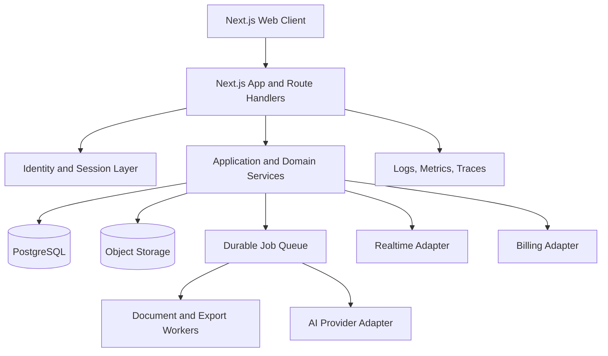

# System Architecture

## Proposed topology

## Boundaries
- Presentation: routes, editor shell, accessible controls, renderer adapter.
- Application: create map, move topic, import/export, restore revision.
- Domain: graph invariants, permissions, commands and revision rules.
- Infrastructure: PostgreSQL, object storage, AI, queue, email and billing.
- Workers: extraction/OCR, AI generation, export, cleanup and notifications.
- Realtime: transport adapter; every operation still passes domain validation.

## Modular monolith first
Start with Next.js modules and clear domain boundaries. Extract workers/services only when measured latency, throughput, isolation or team ownership requires it.

## Mind map engine
Topic IDs are stable and independent of labels/coordinates. Parent-child hierarchy and cross-links are separate. Viewport state is session/user state by default. A layout engine maps graph/config to coordinates; renderer maps pointer/touch/keyboard actions to validated domain commands. Use viewport culling and incremental layout for large maps.

## Persistence and jobs
PostgreSQL owns canonical metadata, graph, revisions, memberships and audit. Object storage owns uploads and large export artifacts. Jobs require ID, idempotency key, status, bounded retries, attempt count, timestamps, correlation ID and safe cancellation. Do not retry permanent validation or permission errors.

## Observability
Track save latency/failure, editor load, export duration, queue depth, AI usage/cost, collaboration conflicts and authorization denials. Redact content and secrets.
