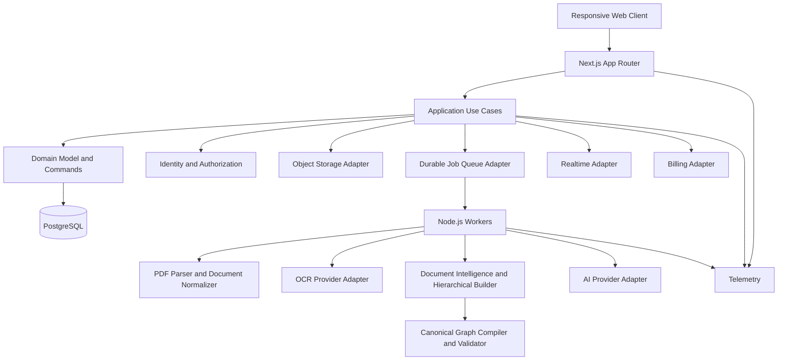
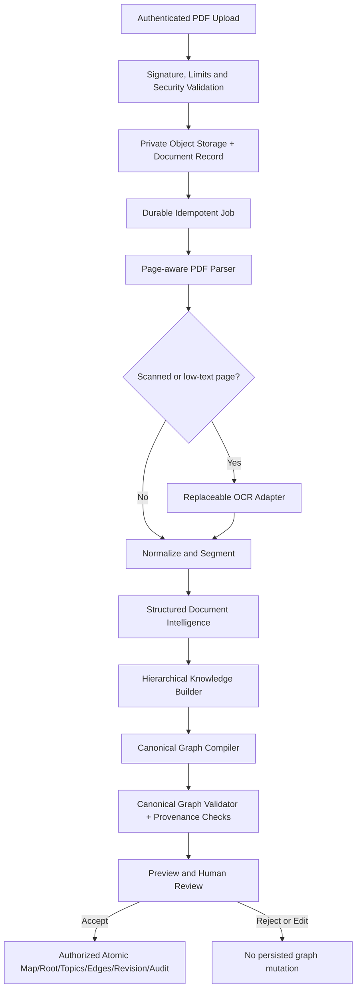

# System Architecture

## Architecture objective
Build a fast, accessible, responsive and extensible mind-mapping platform whose domain model can support future features without rewriting the core. Optimize for measured performance, data integrity, portability and replaceable infrastructure—not for the largest number of technologies.

## Proposed topology

## Current platform allocation: GitHub + Cloudflare + Supabase

This is the initial deployment baseline, with provider-specific access kept behind configuration and adapters.

- **GitHub:** canonical source repository, pull requests, issues, code review, GitHub Actions CI, security/dependency checks and deployment workflow definitions. Use protected release gates where repository settings allow.
- **Cloudflare:** DNS and domain management; proxy/WAF and rate-limiting capabilities where supported by the selected plan; TLS configuration; optional caching for public static assets; and the edge layer for the public application hostname. Do not cache authenticated or tenant-private responses by default.
- **Supabase:** managed PostgreSQL as the canonical relational store. Supabase Auth may be used for identity/session management; Supabase Storage may be used for uploads and generated artifacts if its access policies and operational needs fit. Treat Supabase Realtime as an optional adapter, not a requirement of the canonical graph engine.
- **Application runtime:** deploy the Next.js Node.js application to a compatible Node.js hosting target. Cloudflare may proxy traffic to this runtime; do not assume every Next.js Node.js capability runs unchanged on Cloudflare Workers. If a Worker is introduced later, it must be a distinct edge adapter with compatibility tests.
- **Secrets:** store runtime secrets in the chosen deployment platform's secret manager; keep only variable names and safe placeholders in GitHub. Never commit service-role keys, database passwords, private tokens or production URLs containing credentials.

### Request and data flow
1. Developer changes flow through GitHub pull request and CI checks.
2. The approved build is deployed to the selected Node.js runtime.
3. User requests arrive through Cloudflare DNS/proxy and TLS.
4. The application verifies identity and authorization on the server, then accesses Supabase/PostgreSQL using the least-privilege connection appropriate for the operation.
5. Upload and asynchronous-job paths use configured storage/queue adapters; public caching is restricted to explicitly cache-safe resources.

### Provider boundaries and portability
- Use a repository/service interface for persistence, an identity interface for authentication, a blob-storage interface for files and an edge/deployment configuration boundary.
- Keep domain services independent of Supabase SDK types. Convert provider responses into application-owned types.
- Database schema and migrations remain versioned in this repository; Supabase is the hosted database target, not the only copy of the schema.
- Enforce tenant isolation using server authorization and carefully tested PostgreSQL RLS policies where appropriate. Never assume RLS alone replaces authorization tests.
- Have a documented path to migrate storage, auth, database hosting, or edge protection independently.
- Plan backups and test restore procedures for the Supabase database and object storage before production launch.

## Technology policy
- Web application: Next.js App Router, React and strict TypeScript; use stable releases pinned in the lockfile.
- Runtime: supported Node.js LTS at implementation time; avoid experimental runtime features on the critical path.
- Database: a currently supported stable PostgreSQL release; use versioned SQL migrations and test against the same major version as production. Do not adopt release candidates for production.
- Validation/contracts: shared, runtime-validated schemas at trust boundaries; derive TypeScript types where practical.
- Rendering: a renderer adapter with a benchmarked initial implementation. Keep graph/domain logic independent from SVG, Canvas, WebGL, or third-party graph libraries.
- Storage: S3-compatible object-storage adapter for binary uploads and generated artifacts; never store large binaries directly in ordinary graph records.
- Jobs: durable queue adapter with idempotency, bounded retries, dead-letter handling, observability and safe cancellation.
- Realtime: transport-neutral collaboration interface; start only when needed, and keep authorization/domain validation authoritative on the server.
- AI, email, billing, OCR, PDF parsing and export: provider adapters with explicit capability contracts; never couple domain rules to one vendor.
- Deployment: container-ready Node.js service, environment validation, health/readiness endpoints, graceful shutdown and repeatable migrations.

## Boundaries and modularity
- Presentation: routes, accessible controls, responsive shell, editor state and renderer adapter.
- Application: use cases such as create map, move topic, import, export and restore revision.
- Domain: graph invariants, command semantics, permissions, revisions and entitlements.
- Infrastructure: PostgreSQL, object storage, queues, email, AI and billing adapters.
- Workers: document extraction/OCR, exports, AI generation, notifications and cleanup.
- Realtime: synchronization transport only; operations still pass through domain validation.
- Modules communicate through explicit interfaces and typed contracts. Avoid circular dependencies and cross-module database writes.

## Document Intelligence pipeline

PDF-to-MindMap is a bounded document-processing workflow that feeds the canonical graph; it is not a second graph engine or editor.

- The worker stores page-aware extraction artifacts outside ordinary graph rows. The proposal carries source spans and extraction metadata; the compiler targets the existing canonical graph contract.
- Parser, OCR, AI, object storage and queue are replaceable adapters. Provider SDK types do not cross into domain packages.
- Job stages are durable, idempotent, resumable and observable; transient errors retry with bounded backoff, permanent validation/authorization errors do not.
- Documents and extracted text are untrusted input. Prompt injection is never executable instruction. Enforce tenant authorization, private object access, signed-link expiry, file/page/time/memory limits, quotas, retention and redacted telemetry.
- The preview is isolated from persistence. Explicit acceptance invokes the same server-side authorization, domain validation, optimistic concurrency, revision and audit boundary as manual edits.
- Detailed contracts and release gates live in [PDF-to-MindMap Intelligence Engine Blueprint](PDF_TO_MINDMAP_INTELLIGENCE_BLUEPRINT.md).

## Mind map engine
- Stable UUID topic IDs independent of label, parent, ordering and coordinates.
- Explicitly separate tree hierarchy from typed cross-links; enforce no self-links/cycles where prohibited.
- Keep canonical graph data separate from layout coordinates, viewport preferences and ephemeral UI state.
- Represent edits as validated domain commands with deterministic undo/redo behavior.
- Use incremental layout, viewport culling, batched updates and virtualization where useful.
- Support keyboard, pointer, touch and accessible outline navigation; canvas interactions must have a semantic alternative.
- Keep renderer interchangeable. Benchmark SVG and Canvas (and WebGL only if evidence justifies it) using realistic small, medium and large maps before choosing the production default.
- Plan for stale revisions and concurrent edits. Introduce CRDT/OT only after collaboration semantics are defined and evaluated; do not prematurely make it the source of truth.

## Data integrity and persistence
- PostgreSQL owns canonical maps, topics, edges, memberships, revisions, audit events and job metadata as appropriate.
- Use foreign keys, unique constraints, transactions and explicit optimistic-concurrency/version checks.
- Every tenant-scoped query and mutation must be authorized server-side; add database-level defense-in-depth such as row-level security only with carefully tested policies.
- Migrations are versioned, reviewed, forward-tested and never silently applied on application startup in production.
- Import is validate → preview → commit; export is tested with round-trip fixtures.
- Autosave exposes pending/saved/error states, uses idempotent writes and recovers drafts after connectivity failures.
- Restore creates a new revision rather than silently erasing history.

## Performance and responsiveness
- Prefer Server Components for server-rendered non-interactive surfaces and isolate Client Components to interactive editor boundaries.
- Use route-level code splitting, lazy-load heavy editor/export/AI modules, and avoid unnecessary client JavaScript.
- Use streaming/loading boundaries where they improve perceived performance; define cache policy per data sensitivity and freshness.
- Keep the editor responsive on mobile and tablet with adaptive controls, touch targets and orientation-aware layout.
- Use Web Workers for CPU-heavy client calculations when profiling shows main-thread blocking.
- Establish budgets for bundle size, map load, interaction latency, autosave latency and large-map rendering; profile before optimizing.
- Support horizontal scaling by externalizing durable state, coordinating cache invalidation, and ensuring workers/jobs are safe across multiple instances.

## Security, reliability and observability
- Validate inputs at all trust boundaries; protect against XSS, CSRF where relevant, SSRF, unsafe file uploads, IDOR and abuse.
- Enforce least privilege, secure session handling, rate limits, quotas, signed expiring links and secret management.
- Jobs require ID, idempotency key, status, attempt count, timestamps, correlation ID, retry policy and dead-letter path.
- Retry transient errors only; do not retry permanent validation or permission failures.
- Track save latency/failures, editor load and interaction latency, export duration, queue depth, AI usage/cost, collaboration conflicts and authorization denials.
- Redact user content, tokens and secrets from logs. Define backup, restore drills, incident response and retention policies.

## Extensibility contract
Every optional subsystem must be replaceable behind a narrow interface and covered by contract tests. Add new capabilities as modules with migrations, permission rules, telemetry, documentation and tests. Use feature flags for staged rollout where appropriate. Avoid microservices until measured scale, isolation or team ownership justifies the operational cost.
